<<<<<<< HEAD
# Лабораторная работа №1: Временная и частотная формы сигналов. Преобразования Фурье. Дискретизация сигналов

**Вариант:** 22  
**Исходный сигнал:** $y(t) = 2\sin\left(2\pi \cdot 9t + \frac{\pi}{4}\right)$

---

##  Краткая теория

### Теорема Котельникова
Сигнал с максимальной частотой $f_{max}$ можно точно восстановить по отсчётам, если частота дискретизации:
$$f_s > 2 \cdot f_{max}$$

### Дискретное преобразование Фурье (ДПФ)
Переход из временной области в частотную:
$$F(k) = \sum_{n=0}^{N-1} x(n) \cdot e^{-j2\pi\frac{kn}{N}}$$

### Квантование
АЦП с разрядностью $B$ бит имеет $L = 2^B$ уровней. Шаг квантования:
$$\Delta = \frac{A_{max} - A_{min}}{2^B - 1}$$

---

##  Выполненные пункты

### Пункты 1–3. Непрерывный сигнал и теорема Котельникова
- Максимальная частота: $f_{max} = 9$ Гц
- Минимальная частота дискретизации: $f_s > 18$ Гц
- Выбранная базовая частота: $f_s = 19$ Гц

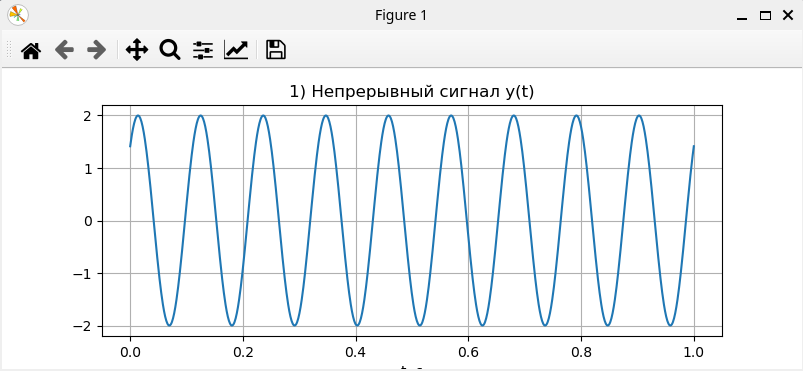
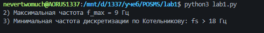
---

### Пункты 4–5-6. Дискретизация и ДПФ, восстановление сигнала
- Оцифровка при $f_s = 19$ Гц (19 отсчётов за 1 секунду).
- Ручной расчёт ДПФ через двойной цикл.
- Объём памяти для хранения массива (float64): 152 байта.
- Ширина спектра: 9 Гц. Спектр содержит два пика на частотах -9 Гц и +9 Гц.
- Восстановление путём линейной интерполяции. Из-за минимального запаса по теореме Котельникова сигнал имеет форму грубой ломаной линии.

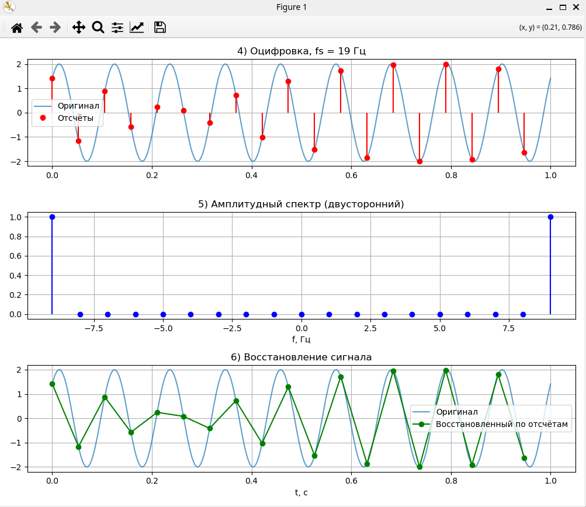
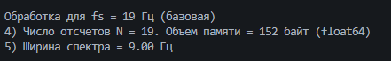

---

### Пункт 7. Увеличение частоты дискретизации в 4 раза
Эксперимент повторён для $f_s = 76$ Гц. При увеличении количества отсчётов восстановленный сигнал визуально почти идеально сливается с исходной синусоидой.

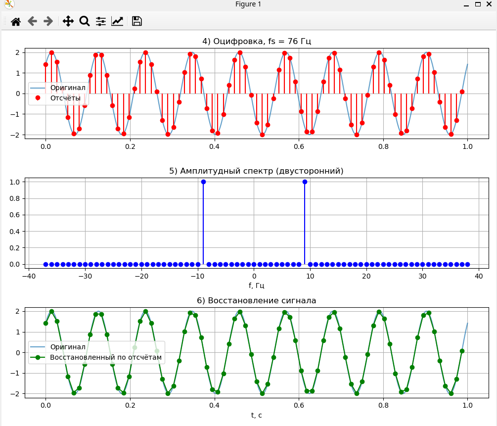
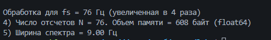

---

### Пункты 8–10. Запись голоса и анализ в Audacity
- Аудиофайл: `voice.wav`
- Частота дискретизации: $F_s = 44\,100$ Гц
- Количество отсчётов: $N = 177\,947$
- Длительность: $T \approx 4.035$ с
- Проверка: $N / T \approx 44\,101$ Гц (совпадает с $F_s$ с учётом округления).

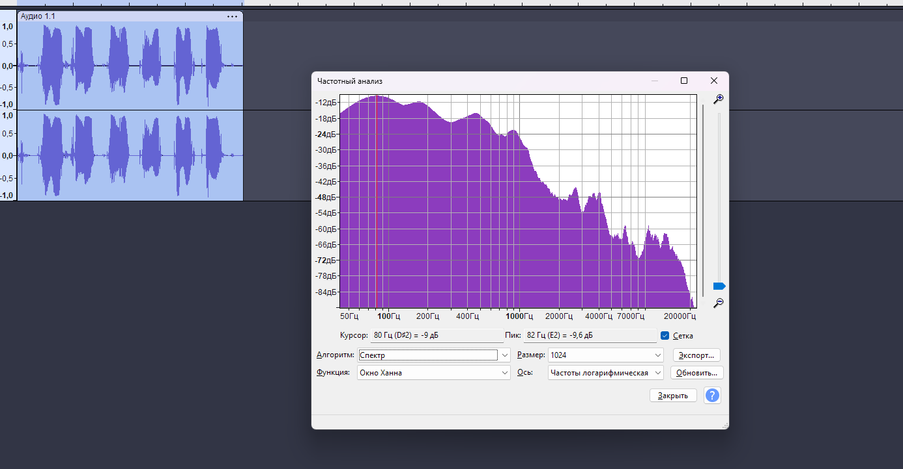
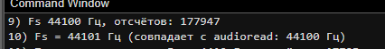

---

### Пункты 11–12. Прореживание и эффект алиасинга
- Сигнал прорежен в 10 раз: $F_{s1} = 4\,410$ Гц, $N_1 = 17\,795$ отсчётов.
- Частота Найквиста снизилась до 2205 Гц, что нарушает теорему Котельникова для голоса.
- **Ширина спектра (порог 1% от макс. амплитуды):**
  - Оригинал: **1588 Гц**
  - Прореженный: **1882 Гц** (ширина увеличилась из-за наложения спектров — алиасинга).

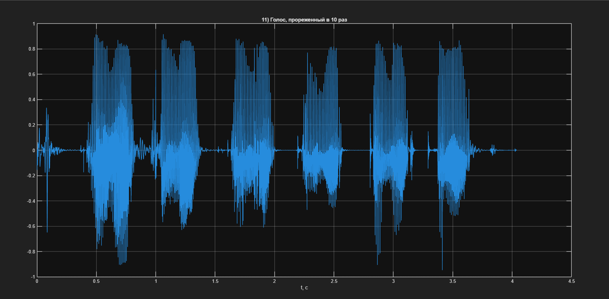
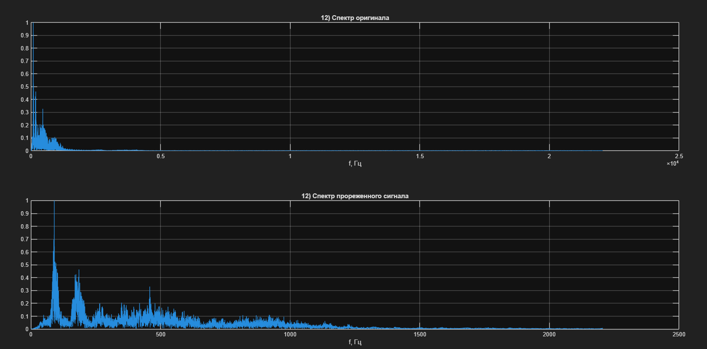
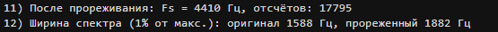

---

### Пункт 13. Влияние разрядности АЦП на спектр
Смоделировано квантование синусоидального сигнала с разрядностью 3, 4, 5 и 6 бит. При низкой разрядности в спектре появляются паразитные гармоники (шум квантования).

| Разрядность, бит | Уровней ($L$) | Средняя ошибка квантования |
|:---:|:---:|:---:|
| 3 | 8 | 0.1279 |
| 4 | 16 | 0.0624 |
| 5 | 32 | 0.0361 |
| 6 | 64 | 0.0152 |

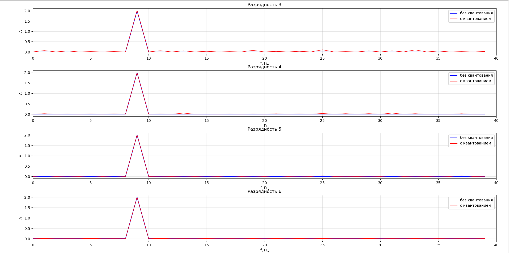
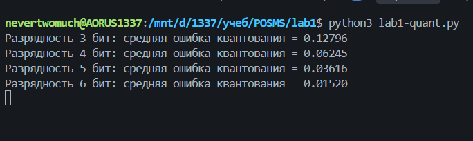

---

=======
# Основы систем мобильной связи (ОСМС)

**Студент:** Фадеев Е. А.  
**Группа:** ИКС-431  
**Преподаватель:** Дроздова В. Г.  

---

## Выполненные лабораторные работы

### Лабораторная работа №1
**Тема:** Временная и частотная формы сигналов. Преобразования Фурье. Дискретизация.  
**Краткое содержание:** Изучение теоремы Котельникова, ручная реализация ДПФ на Python, анализ влияния частоты дискретизации и разрядности АЦП (квантование) на спектр сигнала. Практическая работа с голосовым сигналом в MATLAB и Audacity для демонстрации эффекта алиасинга.  
 **[Перейти к материалам работы](./lab1/)**

---

###  Лабораторная работа №2
*(Будет добавлено по мере выполнения)*

---
>>>>>>> origin/main
