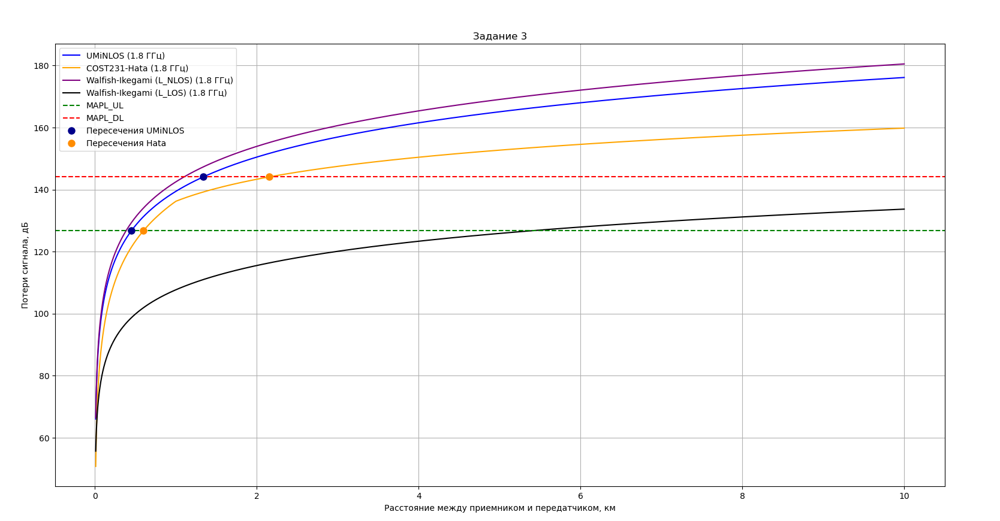
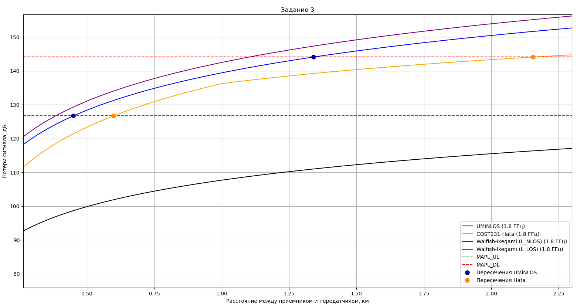
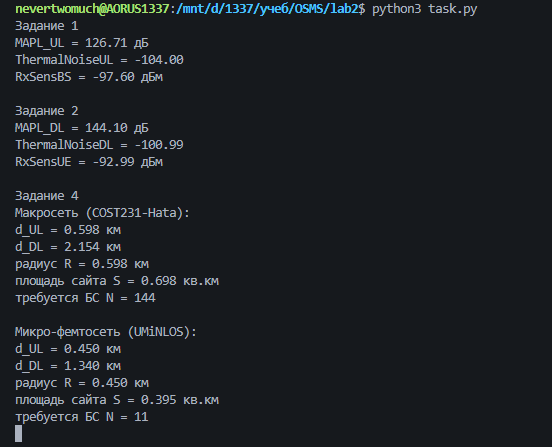

# Лабораторная работа №2: Проектирование радиопокрытия мобильных сетей. Модели распространения сигналов. Бюджеты каналов

**Исходные данные:** PBS = 46 дБм, PUE = 24 дБм, GBS = 21 дБи, MIMO 2×2, IM = 1 дБ, PenetrationM = 15 дБ, f = 1.8 ГГц, BWUL = 10 МГц, BWDL = 20 МГц, NFBS = 2.4 дБ, NFUE = 6 дБ, SINRUL = 4 дБ, SINRDL = 2 дБ, 3 сектора, площади 100 и 4 км², БС с фидерами.

**Дополнительные данные(заданы самостоятельно):** hBS = 30 м, hms = 1.5 м, тип местности Urban (Lclutter = 0); для Walfish‑Ikegami: дельта h = 20 м, w = 20 м, b = 30 м, φ = 45 градусов..

---

## Краткая теория

### Модели распространения потерь $PL(d)$

**FSPM** (модель свободного пространства) — базовая аналитическая модель, в реальных сетях не применяется:

$$PL = 20\log_{10}\!\left(\frac{4\pi d f}{c}\right)$$

**UMiNLOS** — для помещений и малых сот (фемто/микро), $f$ в ГГц, $d$ в м:

$$PL(d) = 26\log_{10}(f_{\text{ГГц}}) + 22.7 + 36.7\log_{10}(d_{\text{м}})$$

**COST231‑Hata** — основная модель макросот (150–2000 МГц, $h_{BS}$ 30–200 м, радиус 1–20 км), $f$ в МГц, $d$ в км:

$$PL(d) = A + B\log_{10}(f) - 13.82\log_{10}(h_{BS}) - a(h_{ms}) + s\log_{10}(d) + L_{clutter}$$

где $A,B$ — константы диапазона частот, $a(h_{ms})$ — поправка на высоту UE и тип местности, $L_{clutter}$ — потери на препятствия, $s$ — коэффициент, зависящий от расстояния (ветки $d\ge1$ км и $d<1$ км).

**Walfish‑Ikegami** — городская застройка «манхэттенского» типа (800–2000 МГц, радиус 30 м–6 км). Различают зоны LOS и NLOS. Для LOS:

$$L_{LOS} = 42.6 + 20\log_{10}(f) + 26\log_{10}(d)$$

Для NLOS потери складываются из свободного пространства $L_0$, переотражений от стен $L_1$ и от крыш $L_2$:

$$L_{NLOS} = \begin{cases} L_0 + L_1 + L_2, & L_1+L_2>0 \\ L_0, & L_1+L_2\le 0 \end{cases}$$

### Бюджеты каналов и $MAPL$

Чувствительность приёмника и тепловой шум:

$$RxSens = NF + \text{ThermalNoise} + \text{RequiredSINR}, \qquad \text{ThermalNoise} = -174 + 10\log_{10}(BW)\ \text{дБм}$$

Бюджет DL (от БС к UE) и UL (от UE к БС) приравниванием левой и правой частей дают максимально допустимые потери $MAPL$:

$$P_{BS} - L_{feed} + G_{BS} + G_{MIMO} - MAPL_{DL} - IM - Pen = RxSens_{UE}$$
$$P_{UE} - L_{feed} + G_{BS} + G_{MIMO} - MAPL_{UL} - IM - Pen = RxSens_{BS}$$

### Радиус и площадь соты

Радиусы $d_{UL}, d_{DL}$ — точки пересечения $PL(d)$ с уровнями $MAPL_{UL}, MAPL_{DL}$. Итоговый радиус $R=\min(d_{UL},d_{DL})$ (покрытие ограничивает худшее направление). Площадь 3‑секторной БС: $S = 1.95\,R^2$. Количество сайтов: $N=\lceil S_{\text{терр}} / S\rceil$.

---

## Выполненные пункты

### Пункты 1–2. Бюджеты UL и DL

| Величина | UL | DL |
|:---|:---:|:---:|
| ThermalNoise, дБм | $-104.00$ | $-100.99$ |
| RxSens, дБм | $-97.60$ (BS) | $-92.99$ (UE) |
| **MAPL, дБ** | **$126.71$** | **$144.10$** |

$MAPL_{UL} < MAPL_{DL}$ из‑за меньшей мощности передатчика UE (24 дБм против 46 дБм).

### Пункт 3. Зависимости $PL(d)$ по трём моделям

Построены UMiNLOS, COST231‑Hata, Walfish‑Ikegami (LOS и NLOS) и нанесены уровни $MAPL_{UL}$, $MAPL_{DL}$.

**Анализ:**
1. Все модели монотонно возрастают с логарифмическим характером роста.
2. Наименьшие потери — Walfish‑Ikegami (LOS, без препятствий), далее COST231‑Hata; наибольшие — Walfish‑Ikegami (NLOS, учёт застройки).
3. Излом COST231‑Hata при $d=1$ км — переключение коэффициента $s$ (ветки формулы 2.7).
4. $MAPL_{UL}$ ниже $MAPL_{DL}$, поэтому пересечение в UL всегда ближе — покрытие ограничено восходящим каналом.

### Пункт 4. Радиусы, площади и количество БС

Радиусы найдены как пересечения $PL(d)$ с $MAPL$ и подтверждены графически.

| Система | Модель | $d_{UL}$, км | $d_{DL}$, км | $R=\min$, км | $S=1.95R^2$, км$^2$ | Площадь, км$^2$ | $N$ |
|:---|:---|:---:|:---:|:---:|:---:|:---:|:---:|
| Макросеть | COST231‑Hata | $0.598$ | $2.154$ | $0.598$ | $0.698$ | $100$ | **144** |
| Микро/фемто | UMiNLOS | $0.450$ | $1.340$ | $0.450$ | $0.395$ | $4$ | **11** |

В обеих системах ограничивающим является UL.

**Вывод программы (все задания):**

## Вывод

Рассчитаны бюджеты каналов ($MAPL_{UL}=126.71$ дБ, $MAPL_{DL}=144.10$ дБ) и построены зависимости потерь от расстояния для моделей UMiNLOS, COST231‑Hata и Walfish‑Ikegami. Радиус соты ограничен восходящим каналом: для макросот $R=0.598$ км, для микро/фемтосот $R=0.450$ км. Для покрытия 100 км2 требуется **144** БС, для торговых и бизнес‑центров площадью 4 км2 - **11**.

